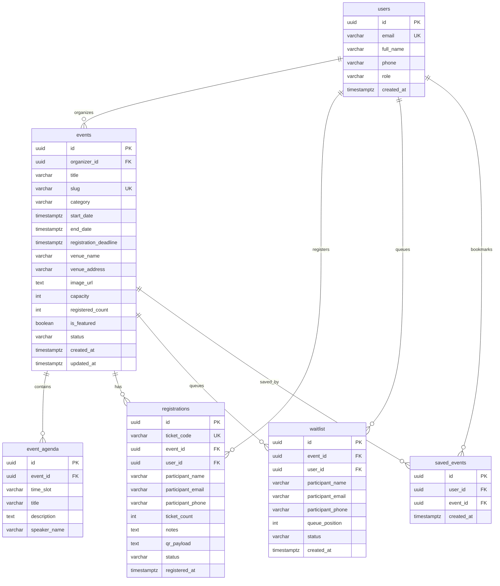

# K Explore — Database Design & Schema Specification

- **Document ID:** DB-KEXP-001
- **Version:** 1.0.0
- **Status:** APPROVED BASELINE
- **Target RDBMS:** PostgreSQL 15+ (Supabase Native)
- **Local Fallback Storage:** Strongly-Typed LocalStorage JSON Document Store

---

## 1. Relational Schema Architecture (PostgreSQL)

The database enforces referential integrity through foreign keys, check constraints, unique compound indexes, and Row Level Security (RLS) policies.



---

## 2. Table DDL & Constraints

### 2.1 Table: `users`
```sql
CREATE TABLE public.users (
    id UUID PRIMARY KEY DEFAULT gen_random_uuid(),
    email VARCHAR(255) NOT NULL UNIQUE,
    full_name VARCHAR(100) NOT NULL,
    phone VARCHAR(25),
    role VARCHAR(20) NOT NULL DEFAULT 'attendee' CHECK (role IN ('attendee', 'organizer', 'admin')),
    avatar_url TEXT,
    created_at TIMESTAMPTZ NOT NULL DEFAULT timezone('utc', now())
);

CREATE INDEX idx_users_email ON public.users(email);
CREATE INDEX idx_users_role ON public.users(role);
```

### 2.2 Table: `events`
```sql
CREATE TABLE public.events (
    id UUID PRIMARY KEY DEFAULT gen_random_uuid(),
    organizer_id UUID NOT NULL REFERENCES public.users(id) ON DELETE RESTRICT,
    title VARCHAR(200) NOT NULL,
    slug VARCHAR(220) NOT NULL UNIQUE,
    category VARCHAR(50) NOT NULL CHECK (category IN ('tech', 'workshop', 'cultural', 'sports', 'arts', 'business')),
    short_description VARCHAR(300) NOT NULL,
    full_description TEXT NOT NULL,
    start_date TIMESTAMPTZ NOT NULL,
    end_date TIMESTAMPTZ NOT NULL,
    registration_deadline TIMESTAMPTZ NOT NULL,
    venue_name VARCHAR(150) NOT NULL,
    venue_address VARCHAR(255) NOT NULL,
    venue_map_url TEXT,
    image_url TEXT NOT NULL,
    capacity INTEGER NOT NULL CHECK (capacity > 0),
    registered_count INTEGER NOT NULL DEFAULT 0 CHECK (registered_count >= 0),
    is_featured BOOLEAN NOT NULL DEFAULT FALSE,
    status VARCHAR(20) NOT NULL DEFAULT 'published' CHECK (status IN ('draft', 'published', 'cancelled', 'completed')),
    created_at TIMESTAMPTZ NOT NULL DEFAULT timezone('utc', now()),
    updated_at TIMESTAMPTZ NOT NULL DEFAULT timezone('utc', now())
);

CREATE INDEX idx_events_category ON public.events(category);
CREATE INDEX idx_events_start_date ON public.events(start_date);
CREATE INDEX idx_events_featured ON public.events(is_featured);
CREATE INDEX idx_events_organizer ON public.events(organizer_id);
```

### 2.3 Table: `event_agenda`
```sql
CREATE TABLE public.event_agenda (
    id UUID PRIMARY KEY DEFAULT gen_random_uuid(),
    event_id UUID NOT NULL REFERENCES public.events(id) ON DELETE CASCADE,
    time_slot VARCHAR(50) NOT NULL,
    title VARCHAR(150) NOT NULL,
    description TEXT,
    speaker_name VARCHAR(100)
);

CREATE INDEX idx_agenda_event_id ON public.event_agenda(event_id);
```

### 2.4 Table: `registrations`
```sql
CREATE TABLE public.registrations (
    id UUID PRIMARY KEY DEFAULT gen_random_uuid(),
    ticket_code VARCHAR(50) NOT NULL UNIQUE,
    event_id UUID NOT NULL REFERENCES public.events(id) ON DELETE RESTRICT,
    user_id UUID REFERENCES public.users(id) ON DELETE SET NULL,
    participant_name VARCHAR(100) NOT NULL,
    participant_email VARCHAR(255) NOT NULL,
    participant_phone VARCHAR(25) NOT NULL,
    ticket_count INTEGER NOT NULL DEFAULT 1 CHECK (ticket_count > 0),
    notes TEXT,
    qr_payload TEXT NOT NULL,
    status VARCHAR(20) NOT NULL DEFAULT 'confirmed' CHECK (status IN ('confirmed', 'cancelled')),
    registered_at TIMESTAMPTZ NOT NULL DEFAULT timezone('utc', now()),
    CONSTRAINT uq_event_email_active UNIQUE (event_id, participant_email, status)
);

CREATE INDEX idx_reg_event ON public.registrations(event_id);
CREATE INDEX idx_reg_user ON public.registrations(user_id);
CREATE INDEX idx_reg_email ON public.registrations(participant_email);
CREATE INDEX idx_reg_ticket_code ON public.registrations(ticket_code);
```

### 2.5 Table: `waitlist`
```sql
CREATE TABLE public.waitlist (
    id UUID PRIMARY KEY DEFAULT gen_random_uuid(),
    event_id UUID NOT NULL REFERENCES public.events(id) ON DELETE CASCADE,
    user_id UUID REFERENCES public.users(id) ON DELETE SET NULL,
    participant_name VARCHAR(100) NOT NULL,
    participant_email VARCHAR(255) NOT NULL,
    participant_phone VARCHAR(25) NOT NULL,
    queue_position INTEGER NOT NULL CHECK (queue_position > 0),
    status VARCHAR(20) NOT NULL DEFAULT 'waiting' CHECK (status IN ('waiting', 'promoted', 'cancelled')),
    created_at TIMESTAMPTZ NOT NULL DEFAULT timezone('utc', now()),
    CONSTRAINT uq_waitlist_event_email UNIQUE (event_id, participant_email)
);

CREATE INDEX idx_waitlist_event ON public.waitlist(event_id);
```

### 2.6 Table: `saved_events`
```sql
CREATE TABLE public.saved_events (
    id UUID PRIMARY KEY DEFAULT gen_random_uuid(),
    user_id UUID NOT NULL REFERENCES public.users(id) ON DELETE CASCADE,
    event_id UUID NOT NULL REFERENCES public.events(id) ON DELETE CASCADE,
    created_at TIMESTAMPTZ NOT NULL DEFAULT timezone('utc', now()),
    CONSTRAINT uq_saved_user_event UNIQUE (user_id, event_id)
);

CREATE INDEX idx_saved_user ON public.saved_events(user_id);
```

---

## 3. Row Level Security (RLS) Policies

When deployed with Supabase, security is enforced directly at the database engine level:

```sql
-- Enable RLS across all tables
ALTER TABLE public.events ENABLE ROW LEVEL SECURITY;
ALTER TABLE public.registrations ENABLE ROW LEVEL SECURITY;
ALTER TABLE public.waitlist ENABLE ROW LEVEL SECURITY;
ALTER TABLE public.saved_events ENABLE ROW LEVEL SECURITY;

-- 1. Events: Everyone can read published events
CREATE POLICY "Public events are viewable by everyone" 
ON public.events FOR SELECT USING (status = 'published');

-- Organizers can manage their own events
CREATE POLICY "Organizers can create events" 
ON public.events FOR INSERT WITH CHECK (auth.uid() = organizer_id);

CREATE POLICY "Organizers can update own events" 
ON public.events FOR UPDATE USING (auth.uid() = organizer_id);

CREATE POLICY "Organizers can delete own events" 
ON public.events FOR DELETE USING (auth.uid() = organizer_id);

-- 2. Registrations: Users can view their own registrations
CREATE POLICY "Users can view own registrations" 
ON public.registrations FOR SELECT 
USING (auth.uid() = user_id OR participant_email = auth.jwt()->>'email');

-- Organizers can view registrations for their own events
CREATE POLICY "Organizers can view event attendees" 
ON public.registrations FOR SELECT 
USING (
    EXISTS (
        SELECT 1 FROM public.events 
        WHERE events.id = registrations.event_id 
        AND events.organizer_id = auth.uid()
    )
);

-- Users can insert registrations
CREATE POLICY "Anyone can register for events" 
ON public.registrations FOR INSERT WITH CHECK (true);

-- Users can cancel their own registration
CREATE POLICY "Users can cancel own registration" 
ON public.registrations FOR UPDATE 
USING (auth.uid() = user_id OR participant_email = auth.jwt()->>'email')
WITH CHECK (status = 'cancelled');
```

---

## 4. LocalStorage Document Mapping (Fallback Engine)

When Supabase environment variables are omitted, the application uses isolated LocalStorage document namespaces:
- `kexp_events_v2`: Array of seeded and user-created `Event` records.
- `kexp_registrations_v2`: Array of `Registration` records with unique `ticket_code` and QR payloads.
- `kexp_waitlist_v2`: Array of `WaitlistEntry` records.
- `kexp_favorites_v2`: Array of saved event IDs keyed by user.
- `kexp_auth_v2`: Current active user profile, token, and simulated role.

All LocalStorage interactions pass through strict `Zod` validation to guarantee zero corrupt data states.
