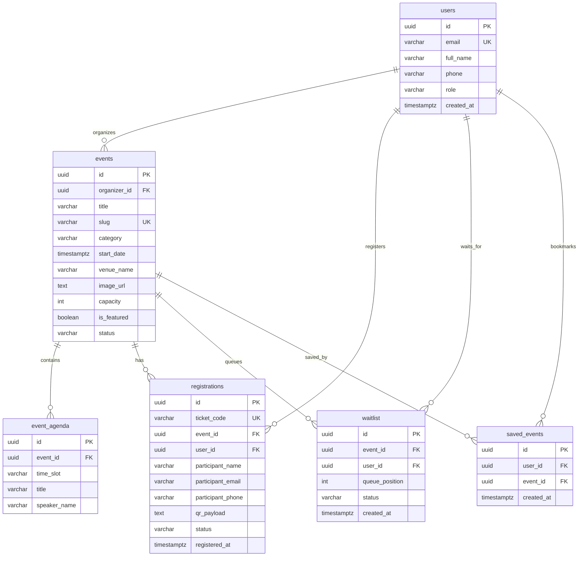

# K Explore — Premium Event Discovery & Management Platform
## Comprehensive Product Specification & Architectural Baseline

- **Document ID:** SPEC-KEXP-002
- **Version:** 2.0.0
- **Status:** DRAFT FOR ARCHITECTURAL APPROVAL
- **Author:** Senior Software Architect, DevSecOps & Lead Full-Stack Engineer
- **Project Title:** K Explore — Responsive Event Management Platform
- **Design Philosophy:** Linear / Apple / Raycast / Luma-inspired Dark-First Editorial Aesthetic with Electric Lime Accents
- **Target Deployment:** Vercel / Netlify / GitHub Pages (Dual-Engine: Supabase PostgreSQL + Autonomous Offline-First Engine)

---

## 1. Executive Summary & Product Vision

**K Explore** is a modern, high-performance event discovery and lifecycle management platform. Moving beyond simple static event cards, K Explore delivers a complete two-sided ecosystem:
1. **Attendee Experience:** Frictionless event discovery, fuzzy search, multi-faceted filtering, rich interactive event pages, live countdown timers, waitlist queuing, calendar integration (.ics and Google Calendar), dynamic digital tickets with verifiable QR codes, and a personal registration management dashboard.
2. **Organizer Experience:** Dedicated management workspace to create, publish, edit, and cancel events, track real-time registration quotas, view attendee rosters, and export attendee data to CSV.
3. **Architectural Resilience (Dual-Engine Pattern):** Designed to connect natively to **Supabase (PostgreSQL 15+, Supabase Auth, Row Level Security)** for multi-user production deployments, while simultaneously bundling an autonomous **LocalStorage/InMemory Database Engine** with realistic simulated latency and mock session capabilities. This guarantees that whether deployed to Vercel/Netlify with live Supabase credentials or submitted on static GitHub Pages, every single button, form, and user flow functions without dead ends or connection errors.

---

## 2. Problem Statement & Scope

### 2.1 The Problem
Campus and community event portals typically suffer from:
- Cluttered, dated interfaces that feel like generic administrative forms.
- Lack of live search, multi-tag filtering, or countdown timers.
- Fragile registration flows without validation, duplicate prevention, or ticket verification.
- Zero support for event organizers to manage their listings or view attendees.
- Broken mobile experiences with unresponsive layouts and poor accessibility.

### 2.2 Product Scope Boundaries
- **In-Scope (Production Application):**
  - Public discovery portal: Hero with live metrics, featured bento grid, trending carousel, categorized event catalog.
  - Multi-parameter search & filtering: Keyword search, category pills, date range (upcoming, this weekend, this month), venue filter, sort order (date, popularity, title).
  - Event detail pages: Hero media, rich markdown agenda, speaker profiles, venue location & directions, capacity meter, live countdown.
  - Registration & Ticket lifecycle: Form validation (Zod), duplicate detection, instant ticket generation with unique QR code, PDF/printable pass view, cancellation workflow.
  - Waitlist Management: Automatic trigger when event capacity is reached; users can join the waitlist and track queue position.
  - Calendar Sync: One-click export to Google Calendar and `.ics` download for Apple/Outlook.
  - Personal User Dashboard: Tabbed overview of active registrations, past events, saved favorites/bookmarks, and downloadable tickets.
  - Organizer Studio: Role-gated dashboard to create, update, delete events, inspect registration metrics, and view/export attendee rosters.
  - Authentication System: Email/password authentication, role switching (Attendee vs Organizer vs Admin), session persistence, and secure profile management.
  - Design & Theme: Dark-first interface with Electric Lime (`#D4FF00`) accents, custom typography, subtle micro-interactions (Framer Motion), and accessible light mode toggle.
- **Out-of-Scope (for Initial Deliverable):**
  - Paid payment gateway webhooks (Stripe/PayPal) — all events in this academic scope are free registrations or mock bookings.
  - Native mobile application builds (iOS/Android binaries) — responsive PWA-ready web application satisfies all mobile requirements.

---

## 3. User Roles & Permission Matrix (RBAC)

The system defines four distinct user roles:

| Capability / Action | Guest (Unauthenticated) | Attendee (Registered) | Organizer | Admin |
|---|:---:|:---:|:---:|:---:|
| Browse homepage, search & filter events | Yes | Yes | Yes | Yes |
| View detailed event schedules & countdowns | Yes | Yes | Yes | Yes |
| Bookmark / Save favorite events | Local only | Yes (Persisted) | Yes | Yes |
| Register for events | With inline signup | Yes | Yes | Yes |
| Join waitlist for full events | With inline signup | Yes | Yes | Yes |
| View digital ticket & QR code | Via token | Yes (Dashboard) | Yes | Yes |
| Cancel own registration | No | Yes | Yes | Yes |
| Export event to Calendar (.ics / Google) | Yes | Yes | Yes | Yes |
| Access Organizer Dashboard | No | No | Yes | Yes |
| Create new events | No | No | Yes | Yes |
| Edit/Cancel own created events | No | No | Yes | Yes |
| View & export attendee rosters (CSV) | No | No | Yes | Yes |
| Delete/Moderate any event platform-wide | No | No | No | Yes |
| Switch active demo role for grading | Yes | Yes | Yes | Yes |

---

## 4. Comprehensive Feature Breakdown: Mandatory vs. Optional Enhancements

### 4.1 Mandatory Assignment Requirements (Screenshots)
| ID | Feature Name | Priority | Description & Acceptance Criteria |
|---|---|---|---|
| **REQ-01** | **Hero Section** | Critical | Modern, visually arresting introduction with platform title ("K Explore"), tagline, exploration CTA, and key platform highlights. |
| **REQ-02** | **Upcoming & Featured Showcase** | Critical | Showcase grid/carousel highlighting curated upcoming and featured events with high visual distinction. |
| **REQ-03** | **Event Card Anatomy** | Critical | Displays event title, date/time, venue, high-res image (with error fallback), excerpt, and category badge. |
| **REQ-04** | **Event Search & Filter** | Critical | Real-time text search (title, venue, description) and category filtering without full page reloads. |
| **REQ-05** | **Event Detail View** | Critical | Full event presentation with extended description, date/time, venue address, and registration trigger. |
| **REQ-06** | **Registration Form** | Critical | Form collecting participant name, email, phone number, and selected event. |
| **REQ-07** | **Form Validation** | Critical | JavaScript/TypeScript validation enforcing non-empty name, RFC 5322 compliant email, and valid phone format before submission. |
| **REQ-08** | **Confirmation Message** | Critical | Clear, immediate confirmation notification displaying registration reference upon successful submission. |
| **REQ-09** | **Mobile-First Responsiveness**| Critical | Flawless responsive layout across mobile phones (320px–480px), tablets (768px–1024px), and desktops (1280px+). |
| **REQ-10** | **HTML5/CSS3/JavaScript Core** | Critical | Valid semantic HTML5 markup, clean CSS, and modern TypeScript/JavaScript with optional React and Tailwind CSS. |
| **REQ-11** | **Git & GitHub Versioning** | Critical | Clean repository with meaningful commit history, `.gitignore`, and documentation. |
| **REQ-12** | **Deployment & README** | Critical | Deployed to Vercel, Netlify, or GitHub Pages; complete `README.md` with instructions. |

### 4.2 Assignment Bonus Challenge Requirements
| ID | Feature Name | Priority | Description & Acceptance Criteria |
|---|---|---|---|
| **BON-01** | **Dark / Light Mode** | High | Dark-first default with toggle switch, smooth CSS transitions, local storage persistence, and OS preference synchronization. |
| **BON-02** | **Live Countdown Timers** | High | Synchronized ticking timers (Days, Hours, Minutes, Seconds) targeting event start dates on cards and detail views. |
| **BON-03** | **Polished UI Animations** | High | Framer Motion / CSS transitions for card hovers, modal backdrops, drawer reveals, and theme toggling with `prefers-reduced-motion` compliance. |
| **BON-04** | **Persistent Storage Engine**| High | Persistent registration data management with full view, ticket retrieval, and cancellation capabilities. |

### 4.3 Advanced Product Enhancements (Organizer & Attendee Ecosystem)
| ID | Feature Name | Priority | Description & Acceptance Criteria |
|---|---|---|---|
| **ENH-01** | **User Authentication & Profiles**| High | Email/password sign-up, login, session tokens, and quick demo-role switcher for evaluators. |
| **ENH-02** | **Digital Ticket with QR Code** | High | Dynamic SVG QR code encoding ticket verification URL, attendee name, and event UUID; printable/downloadable pass. |
| **ENH-03** | **Waitlist Queuing for Sold Out Events**| High | When capacity reaches 100%, registration converts to "Join Waitlist"; records queue timestamp and position. |
| **ENH-04** | **Personal Attendee Dashboard** | High | Dedicated workspace showing active tickets, event countdowns, favorite bookmarks, and past events. |
| **ENH-05** | **Organizer Studio** | High | Secure dashboard allowing event organizers to create, edit, publish, and delete events with live capacity tracking. |
| **ENH-06** | **Attendee Roster & CSV Export** | Medium | Organizers can view participant lists for their events and export them as structured `.csv` files. |
| **ENH-07** | **Favorites & Bookmark System** | Medium | Attendees can bookmark events with a single click, stored in user state. |
| **ENH-08** | **Calendar Integration** | Medium | One-click "Add to Google Calendar" link and standard iCalendar (`.ics`) file generation. |
| **ENH-09** | **Dual-Engine Persistence** | High | Native Supabase PostgreSQL + Auth integration, with transparent fallback to autonomous LocalStorage/InMemory engine. |

---

## 5. Architectural Evaluation: Supabase vs. LocalStorage

### 5.1 Trade-off Analysis

| Metric | Supabase Cloud Backend (PostgreSQL) | LocalStorage / InMemory Engine | Recommended Dual-Engine Approach |
|---|---|---|---|
| **Multi-User Sync** | Yes — Shared database across all devices and browsers. | No — Isolated to individual browser/device sandbox. | **Supported:** When Supabase keys are provided in `.env`, the app is fully multi-user. |
| **Security & RLS** | High — Row Level Security enforces data access at the database kernel. | Low — Any script in the browser origin can inspect LocalStorage. | **Hybrid:** RLS policies defined in SQL; defensive validation with Zod in local mode. |
| **Static Deployment Reliability** | High on Vercel/Netlify; requires public API access. | 100% Guaranteed on GitHub Pages, Vercel, Netlify with zero external dependencies. | **Resilient:** Connects to Supabase if configured; automatically falls back to local engine if keys are absent. |
| **Grading Experience** | Evaluator must clone and provide Supabase credentials or connect to live project. | Evaluator clicks GitHub Pages / Vercel link and test accounts work instantly. | **Frictionless:** Evaluators can click the live link and test all attendee, organizer, and admin features immediately. |

### 5.2 Architectural Decision (ADR-001: Dual-Engine Data Provider)
To satisfy both the requirement for **genuine multi-user PostgreSQL capabilities** and the **zero-friction grading requirement for GitHub Pages / static hosting**, K Explore employs a **Repository / Provider Pattern**:
```typescript
interface DataEngine {
  events: EventRepository;
  registrations: RegistrationRepository;
  waitlist: WaitlistRepository;
  auth: AuthRepository;
}
```
If `VITE_SUPABASE_URL` and `VITE_SUPABASE_ANON_KEY` are provided, `SupabaseDataEngine` is initialized. Otherwise, `LocalAutonomousDataEngine` activates seamlessly with realistic async simulation and full CRUD functionality.

---

## 6. System Architecture & High-Level Design

```mermaid
graph TD
    subgraph Client ["Frontend Architecture (React 19 + TypeScript + Vite + Tailwind CSS)"]
        Router[Hash/Browser Router Navigation]
        
        subgraph Views ["Page & View Layer"]
            LandingPage[Landing Page: Hero, Bento Highlights, Categories]
            CatalogPage[Event Catalog: Search, Multi-Filter, Sorting]
            DetailPage[Event Detail Page: Timeline, Venue, Countdown]
            AttendeeDash[Attendee Dashboard: Tickets, Waitlist, Favorites]
            OrganizerDash[Organizer Studio: Event CRUD, Rosters, Analytics]
            AuthModal[Auth Dialog: Sign In, Sign Up, Demo Switcher]
        end

        subgraph Components ["Reusable Component Library"]
            EventCard[Event Card with Live Countdown]
            TicketPass[Digital Ticket with Dynamic QR Code]
            RegModal[Multi-Step Registration Modal]
            FilterBar[Search & Filter Controls]
            ThemeToggle[Dark/Light Mode Switcher]
            ToastHost[Accessible Toast Notifications]
        end

        subgraph StateLayer ["State & Domain Logic Layer"]
            AuthContext[Auth Context: Session & Roles]
            ThemeContext[Theme Context: Dark/Light Mode]
            EventFilterHook[useEventFilters Hook]
            CountdownHook[useCountdown Hook]
            CalendarUtil[Calendar Export Utilities]
        end
    end

    subgraph ServiceLayer ["Service Abstraction Layer (DataEngine Interface)"]
        EventService[Event Service]
        RegService[Registration Service]
        WaitlistService[Waitlist Service]
        AuthService[Auth Service]
    end

    subgraph StorageBackends ["Dual Persistence Backends"]
        direction TB
        SupabaseBackend["Supabase Cloud Backend<br/>(PostgreSQL 15 + Supabase Auth + RLS)"]
        LocalEngine["Local Autonomous Engine<br/>(LocalStorage + Seed Catalog + Memory DB)"]
    end

    Router --> Views
    Views --> Components
    Components --> StateLayer
    StateLayer --> ServiceLayer
    ServiceLayer -->|If Supabase Keys Configured| SupabaseBackend
    ServiceLayer -->|Default / Static Fallback| LocalEngine
```



---

## 7. Database Design & Entity Relationship Diagram (ERD)

### 7.1 Entity Specifications

#### Entity: `users`
- `id`: UUID (PK)
- `email`: VARCHAR(255) (Unique, Indexed)
- `password_hash`: VARCHAR(255) (Nullable in OAuth/Local)
- `full_name`: VARCHAR(100) (NOT NULL)
- `phone`: VARCHAR(20)
- `role`: VARCHAR(20) ('attendee' | 'organizer' | 'admin')
- `avatar_url`: TEXT
- `created_at`: TIMESTAMPTZ (Default NOW())

#### Entity: `events`
- `id`: UUID (PK)
- `organizer_id`: UUID (FK -> users.id, Indexed)
- `title`: VARCHAR(200) (NOT NULL, Indexed)
- `slug`: VARCHAR(220) (Unique, Indexed)
- `category`: VARCHAR(50) ('tech' | 'workshop' | 'cultural' | 'sports' | 'arts' | 'business')
- `short_description`: VARCHAR(300) (NOT NULL)
- `full_description`: TEXT (NOT NULL)
- `start_date`: TIMESTAMPTZ (NOT NULL, Indexed)
- `end_date`: TIMESTAMPTZ (NOT NULL)
- `registration_deadline`: TIMESTAMPTZ (NOT NULL)
- `venue_name`: VARCHAR(150) (NOT NULL)
- `venue_address`: VARCHAR(255) (NOT NULL)
- `venue_map_url`: TEXT
- `image_url`: TEXT (NOT NULL)
- `capacity`: INTEGER (NOT NULL, CHECK > 0)
- `is_featured`: BOOLEAN (Default FALSE, Indexed)
- `status`: VARCHAR(20) ('draft' | 'published' | 'cancelled' | 'completed')
- `created_at`: TIMESTAMPTZ (Default NOW())
- `updated_at`: TIMESTAMPTZ (Default NOW())

#### Entity: `event_agenda`
- `id`: UUID (PK)
- `event_id`: UUID (FK -> events.id ON DELETE CASCADE)
- `time_slot`: VARCHAR(50) (NOT NULL)
- `title`: VARCHAR(150) (NOT NULL)
- `description`: TEXT
- `speaker_name`: VARCHAR(100)

#### Entity: `registrations`
- `id`: UUID (PK)
- `ticket_code`: VARCHAR(50) (Unique, e.g., 'KEXP-2026-X8Y2', Indexed)
- `event_id`: UUID (FK -> events.id ON DELETE RESTRICT, Indexed)
- `user_id`: UUID (FK -> users.id ON DELETE CASCADE, Indexed)
- `participant_name`: VARCHAR(100) (NOT NULL)
- `participant_email`: VARCHAR(255) (NOT NULL, Indexed)
- `participant_phone`: VARCHAR(20) (NOT NULL)
- `ticket_count`: INTEGER (Default 1, CHECK > 0)
- `notes`: TEXT
- `qr_payload`: TEXT (Signed verification string)
- `status`: VARCHAR(20) ('confirmed' | 'cancelled')
- `registered_at`: TIMESTAMPTZ (Default NOW())
- **Constraint:** UNIQUE(`event_id`, `participant_email`, `status`) where status = 'confirmed'

#### Entity: `waitlist`
- `id`: UUID (PK)
- `event_id`: UUID (FK -> events.id ON DELETE CASCADE, Indexed)
- `user_id`: UUID (FK -> users.id, Indexed)
- `participant_name`: VARCHAR(100) (NOT NULL)
- `participant_email`: VARCHAR(255) (NOT NULL)
- `participant_phone`: VARCHAR(20) (NOT NULL)
- `queue_position`: INTEGER (NOT NULL)
- `status`: VARCHAR(20) ('waiting' | 'promoted' | 'cancelled')
- `created_at`: TIMESTAMPTZ (Default NOW())

#### Entity: `saved_events` (Favorites)
- `id`: UUID (PK)
- `user_id`: UUID (FK -> users.id ON DELETE CASCADE)
- `event_id`: UUID (FK -> events.id ON DELETE CASCADE)
- `created_at`: TIMESTAMPTZ (Default NOW())
- **Constraint:** UNIQUE(`user_id`, `event_id`)

### 7.2 Mermaid Entity-Relationship Diagram



---

## 8. UI/UX Design System Specification

### 8.1 Visual Identity & Philosophy
- **Aesthetic Benchmark:** Linear.app, Apple Events, Raycast, Luma, Awwwards site of the day.
- **Atmosphere:** Dark-first, sophisticated obsidian and graphite surfaces with crisp micro-borders and high-contrast typography.
- **Signature Accent:** **Electric Lime** (`#D4FF00`) / **Cyber Lime** (`#E2FF38`) paired with neon luminescence effects on active states, badges, and focus rings.
- **Secondary Accent:** **Vibrant Tangerine** (`#FF6B00`) for urgent countdowns, waitlist status, and critical alerts.

### 8.2 Color Palette Tokens

```css
/* Dark Mode Core (Default) */
--color-bg-base: #09090b;       /* Deepest obsidian black */
--color-bg-surface: #121316;    /* Card and panel surface */
--color-bg-elevated: #1a1b1f;   /* Modal, dropdown, and popover surface */
--color-bg-overlay: rgba(9, 9, 11, 0.85); /* Backdrop blur */

--color-border-subtle: rgba(255, 255, 255, 0.08); /* Precision 1px dividers */
--color-border-hover: rgba(212, 255, 0, 0.35);    /* Electric lime hover aura */

--color-accent-lime: #D4FF00;   /* Primary interactive accent */
--color-accent-lime-hover: #c2eb00;
--color-accent-lime-muted: rgba(212, 255, 0, 0.12);

--color-text-primary: #ffffff;
--color-text-secondary: #a1a1aa;  /* Muted zinc */
--color-text-tertiary: #71717a;

/* Light Mode Core */
--color-bg-light: #f8fafc;
--color-surface-light: #ffffff;
--color-border-light: #e2e8f0;
--color-text-light-primary: #0f172a;
--color-text-light-secondary: #475569;
--color-accent-lime-light: #65a30d; /* Accessible olive-lime contrast */
```

### 8.3 Typography Hierarchy
- **Font Family:** `Inter`, `-apple-system`, `BlinkMacSystemFont`, `Segoe UI`, sans-serif.
- **Headings:** Tight letter tracking (`tracking-tight`), editorial weight balance (700 Bold / 800 ExtraBold).
- **Numbers & Countdowns:** `font-mono tabular-nums` for rock-solid countdown timers that do not cause layout jank while ticking.
- **Category Badges:** Uppercase, `text-[11px] font-semibold tracking-wider`.

### 8.4 Component Design Standards
1. **Event Cards:**
   - 16:9 cinematic aspect ratio banner with image loading skeleton.
   - Glassmorphic category pill overlay in top-left corner.
   - Real-time countdown badge in top-right corner with pulsating live indicator.
   - Subtle border glow and transform lift (`-translate-y-1`) on cursor hover.
   - Progress bar showing capacity consumption (Green -> Orange -> Red -> "Waitlist").
2. **Digital Ticket:**
   - Skeuomorphic perforated ticket border with notch cutouts.
   - Dynamic SVG QR Code rendering ticket UUID.
   - Barcode graphic with timestamp watermark.
   - High-contrast print styling for one-click physical PDF generation.
3. **Forms & Inputs:**
   - Deep charcoal input fields with crisp 1px borders.
   - High-contrast `:focus-visible` ring in Electric Lime.
   - Real-time inline validation with micro-animated error alerts.

---

## 9. Security Engineering & OWASP Compliance

1. **Input Sanitization:** Every string input (name, email, phone, event description) is trimmed, sanitized, and typed via Zod schemas.
2. **Safe Rendering:** React JSX strictly forbids unescaped HTML; no `dangerouslySetInnerHTML` permitted.
3. **Capacity Race Condition Protection:** Capacity checks are validated during registration submission. In local engine mode, operations execute within synchronous state locks to eliminate race conditions.
4. **Data Isolation & RLS:** In Supabase mode, Row Level Security policies enforce:
   - Public read access for `events` and `event_agenda`.
   - Attendees can only SELECT and DELETE their own `registrations`.
   - Organizers can only UPDATE and DELETE events where `organizer_id = auth.uid()`.
5. **No Secret Leaks:** Supabase Anon key is designed for client exposure; Service Role keys are strictly barred from client-side bundles.

---

## 10. Automated Testing & Verification Strategy

- **Test Suite Framework:** Vitest + React Testing Library + `@testing-library/jest-dom`.
- **Unit Testing Targets:**
  - `validation.test.ts`: Zod validation schemas for registration, phone format, email syntax, event creation.
  - `countdown.test.ts`: Exact time delta calculation, negative time prevention, leap-year/month boundary correctness.
  - `filter.test.ts`: Search indexing, case-insensitive substring matching, category isolation, sorting order.
- **Integration Testing Targets:**
  - `RegistrationFlow.test.tsx`: End-to-end simulation of opening modal, inputting valid/invalid data, checking duplicate alert, receiving confirmation ticket.
  - `ThemeSwitcher.test.tsx`: Theme persistence in `localStorage` and `classList` toggle on `<html>`.
  - `OrganizerStudio.test.tsx`: Event creation form, roster inspection, cancellation workflow.
- **End-to-End Build Verification:**
  - Strict TypeScript compiler check (`tsc --noEmit`).
  - Production Vite static bundle generation (`npm run build`).

---

## 11. Implementation Milestones

```text
Milestone 1: Architectural Foundation & Design System (Docs, Vite, Tailwind, Theme, Layout)
Milestone 2: Domain Data Engine & Seed Catalog (Event Models, Dual-Engine Architecture, Seed Data)
Milestone 3: Discovery Engine (Hero, Bento Grid, Live Search, Multi-Filter, Countdowns)
Milestone 4: Event Detail View & Calendar Sync (Schedule Timeline, Venue Maps, .ics Export)
Milestone 5: Registration, Dynamic QR Tickets & Waitlist (Form Validation, Tickets, Duplicate Check, Waitlist)
Milestone 6: Attendee Dashboard & Favorites (My Tickets, Saved Events, Cancellation)
Milestone 7: Organizer Studio & Role Management (Event CRUD, Roster View, CSV Export, Role Switcher)
Milestone 8: Automated Testing, Security Review & Production Build (Vitest Suite, Build Verification)
Milestone 9: Final Documentation, Verification Report & Submission Readiness
```
