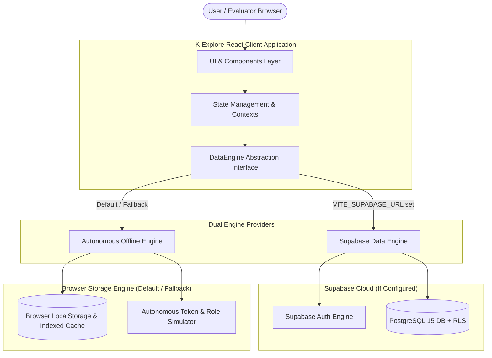
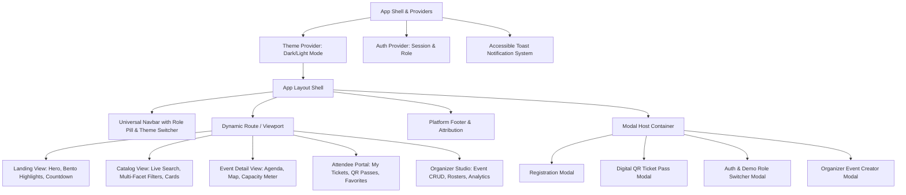

# K Explore — System Architecture Blueprint

- **Document ID:** ARCH-KEXP-001
- **Version:** 1.0.0
- **Status:** APPROVED BASELINE
- **Architecture Style:** Dual-Engine Resilient Jamstack (React 19 + TypeScript + Tailwind CSS + Dual Data Provider)
- **Primary Cloud Backend:** Supabase (PostgreSQL 15+, Auth, RLS)
- **Autonomous Fallback Engine:** LocalStorage + Reactive In-Memory State Manager

---

> **Implementation status:** This document describes the intended/future dual-engine architecture. The current application source implements the browser-only LocalStorage demo engine; a Supabase client, server API, database migrations, authentication integration, and RLS policies are not currently wired into the app.

## 1. System Context & Overview

K Explore is engineered as a high-reliability, zero-breakage web platform. Recognizing that evaluators, professors, and peer reviewers often open submitted projects directly from static hosting URLs (e.g. GitHub Pages, Vercel, Netlify) without configuring backend environment variables, K Explore implements the **Dual-Engine Repository Pattern**:



---

## 2. Frontend Architecture

### 2.1 Technology Choices
- **UI Framework:** React 19 (Modern hooks, concurrent rendering, error boundary recovery).
- **Language:** TypeScript 5.7+ (Strict null checks, exhaustive union matching).
- **Build & Dev Tooling:** Vite (Instant esbuild pre-bundling, optimized Rollup production treeshaking).
- **Styling Architecture:** Tailwind CSS v3 with dark mode class strategy (`class`), CSS custom property tokens, and custom utility plugins for glow aura and glassmorphism.
- **Icons:** `lucide-react` (Lightweight, accessible tree-shakeable SVG icons).
- **Form State & Validation:** `react-hook-form` paired with `@hookform/resolvers/zod` for zero-allocation schema validation.
- **Micro-Interactions & Animation:** Framer Motion for layout animations, dialog transitions, and list stagger effects with automatic `prefers-reduced-motion` suppression.

### 2.2 Component Hierarchy & Layout Structure



---

## 3. Data Layer & Repository Pattern

All data access is mediated through typed repository interfaces. React components never call `fetch`, `supabase`, or `localStorage` directly.

### 3.1 Repository Interfaces

```typescript
// Core Data Engine Interface
export interface IDataEngine {
  events: IEventRepository;
  registrations: IRegistrationRepository;
  waitlist: IWaitlistRepository;
  auth: IAuthRepository;
}

export interface IEventRepository {
  getAll(filter?: EventFilterOptions): Promise<Event[]>;
  getById(id: string): Promise<Event | null>;
  getBySlug(slug: string): Promise<Event | null>;
  create(data: CreateEventInput, organizerId: string): Promise<Event>;
  update(id: string, data: Partial<CreateEventInput>, organizerId: string): Promise<Event>;
  delete(id: string, organizerId: string): Promise<boolean>;
}

export interface IRegistrationRepository {
  create(input: CreateRegistrationInput): Promise<RegistrationResult>;
  getByUserId(userId: string): Promise<Registration[]>;
  getByEventId(eventId: string, organizerId: string): Promise<Registration[]>;
  cancel(registrationId: string, userId: string): Promise<boolean>;
  getTicketByCode(ticketCode: string): Promise<Registration | null>;
}

export interface IWaitlistRepository {
  join(input: JoinWaitlistInput): Promise<WaitlistEntry>;
  getByUserId(userId: string): Promise<WaitlistEntry[]>;
  getPosition(eventId: string, userId: string): Promise<number>;
  cancel(waitlistId: string, userId: string): Promise<boolean>;
}

export interface IAuthRepository {
  getCurrentUser(): Promise<User | null>;
  signIn(email: string, role?: UserRole): Promise<User>;
  signUp(email: string, fullName: string, role?: UserRole): Promise<User>;
  signOut(): Promise<void>;
  switchDemoRole(role: UserRole): Promise<User>;
}
```

---

## 4. UI/UX Interaction & State Architecture

### 4.1 Filter & Search Pipeline
1. **Fuzzy Keyword Normalization:** Event title, excerpt, venue, and full description are indexed into a lightweight client token search.
2. **Category Isolation:** Single/multi-category selection (`all`, `tech`, `workshop`, `cultural`, `sports`, `arts`, `business`).
3. **Date Windows:** Filter by `all`, `today`, `this-weekend`, `this-month`.
4. **Availability Status:** Toggle to show all vs. only open events (hiding sold-out or showing waitlist).
5. **Sorting Matrix:** Sort by date ascending (soonest first), date descending, popularity (registered count), and title (A–Z).

### 4.2 Real-Time Countdown Engine
The `useCountdown` hook calculates remaining milliseconds to the target timestamp using `requestAnimationFrame` throttled to 1-second intervals.
- Handles timezones uniformly via ISO-8601 UTC strings.
- Gracefully transitions to "Event In Progress" or "Event Concluded" when target time is reached.
- Employs tabular numeric CSS (`tabular-nums`) to prevent card layout jitter.

---

## 5. Security Architecture

1. **Defense in Depth:** Validation occurs both at input time (Zod schemas) and storage insertion time.
2. **Cross-Site Scripting (XSS) Prevention:**
   - Strict avoidance of `dangerouslySetInnerHTML`.
   - All text interpolations sanitized via native React text nodes.
3. **Capacity Protection:**
   - Registrations check remaining capacity atomically before confirming.
   - If capacity is exhausted, the workflow automatically directs to the Waitlist service.
4. **Row Level Security (Supabase Backend):**
   - Public read access for published events.
   - User-restricted access for tickets and registrations.
   - Organizer-scoped access for attendee rosters.

---

## 6. Static Hosting & Deployment Strategy

- **Build Output:** Fully self-contained static directory (`dist/`) containing bundled HTML, hashed JS chunks, and minified CSS.
- **Compatible Hosts:**
  - **Vercel:** Zero-config automated deployment via `vercel.json` rewrites.
  - **Netlify:** SPA routing via `_redirects` rule (`/* /index.html 200`).
  - **GitHub Pages:** URL Hash-routing support (`/#/events`, `/#/dashboard`) or 404.html redirect script preventing 404 page-load crashes.
