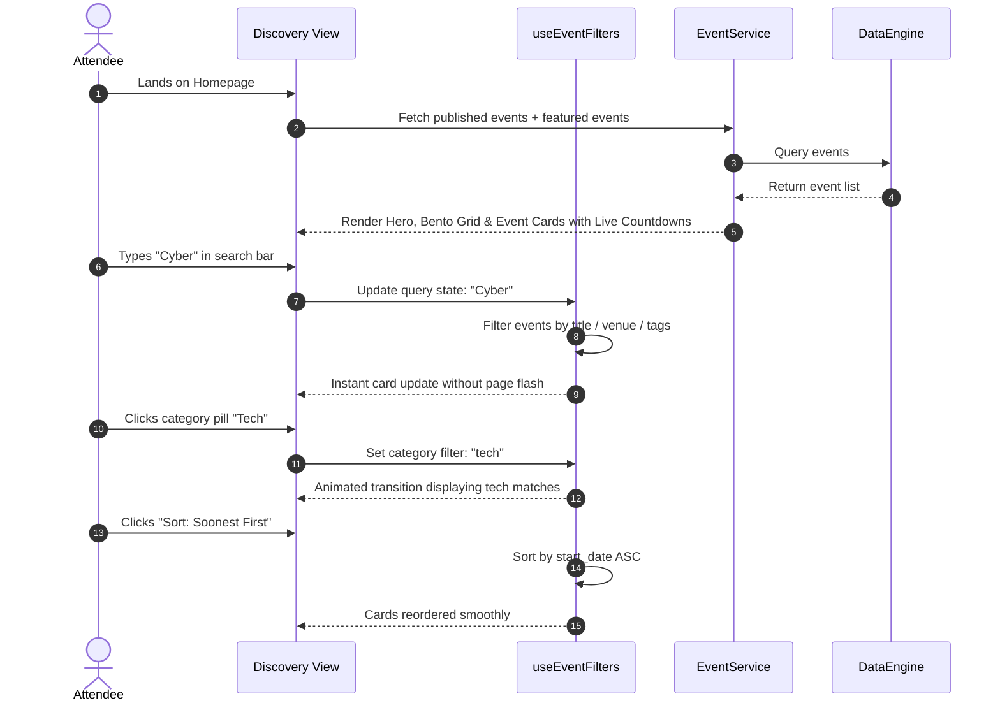
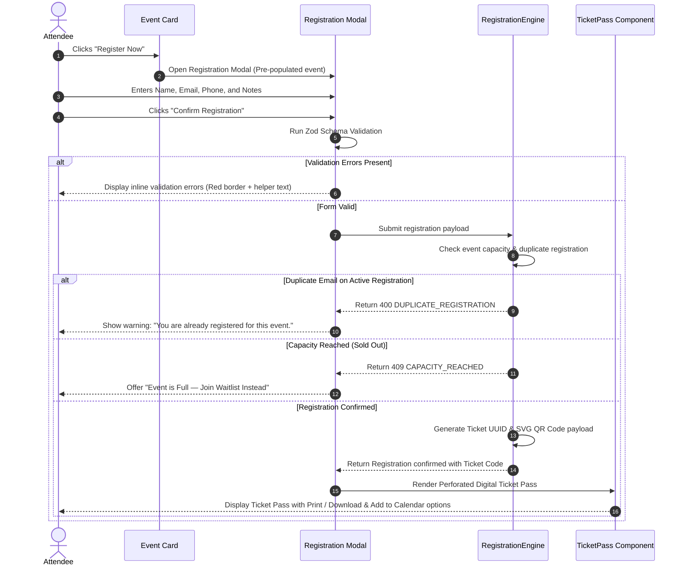
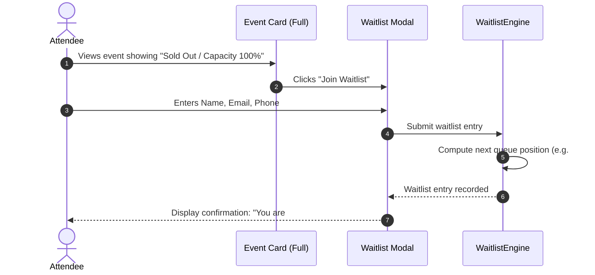
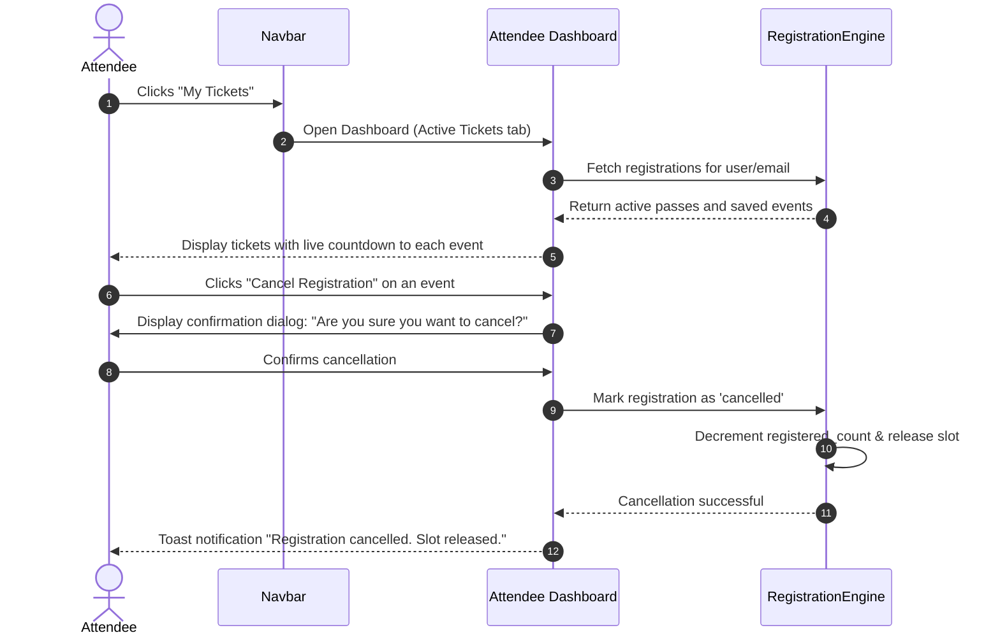
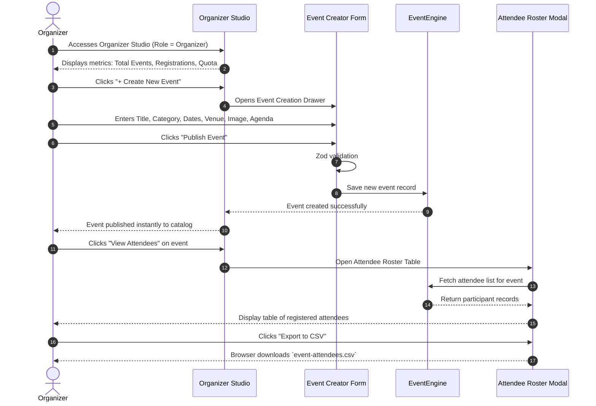

# K Explore — Complete User Journeys & Interaction Flows

- **Document ID:** FLOW-KEXP-001
- **Version:** 1.0.0
- **Status:** APPROVED BASELINE

---

## 1. Flow 1: Attendee Event Discovery & Multi-Faceted Filtering

---

## 2. Flow 2: Event Registration, Capacity Check & Digital Ticket Generation

---

## 3. Flow 3: Waitlist Queuing Workflow

---

## 4. Flow 4: Personal Dashboard (My Registrations, Bookmarks & Cancellation)

---

## 5. Flow 5: Organizer Studio (Event Creation & Attendee Roster Export)

